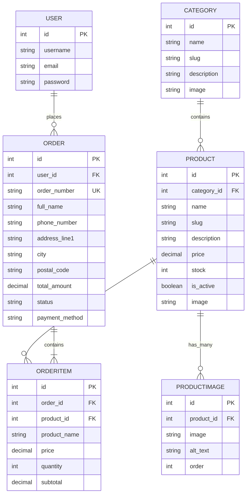

# 🛒 CartNest — Modern E-Commerce Platform

<p align="center">
  
</p>

<p align="center">
  <em>Everyday Finds. A Little More Delightful.</em>
</p>

<p align="center">
  
  
  
  
  
  
</p>

---

## 📖 Overview

**CartNest** is a full-stack, production-grade E-Commerce web application built using **Python**, **Django**, **Vanilla CSS3**, and **Vanilla JavaScript** — completely free of bulky frontend frameworks like React, Next.js, or TailwindCSS. 

Engineered with clean architectural principles, CartNest delivers:
- **Instant performance** with minimal footprint.
- **ACID-compliant atomic order processing** with row-level locks preventing race conditions and overselling.
- **Strict zero-trust security** where prices and calculations are strictly validated server-side.
- **A modern, glassmorphic UI design system** with smooth interactions, dynamic multi-image galleries, live cart counter, and responsive mobile layout.

---

## 📑 Table of Contents

- [Key Features](#-key-features)
  - [Storefront & Catalog](#-storefront--catalog)
  - [Product Showcase & Multi-Angle Gallery](#-product-showcase--multi-angle-gallery)
  - [Shopping Cart & Session Management](#-shopping-cart--session-management)
  - [Checkout & ACID Atomic Order Processing](#-checkout--acid-atomic-order-processing)
  - [User Accounts & Order History](#-user-accounts--order-history)
  - [In-App Admin Toolbar & Django Admin](#-in-app-admin-toolbar--django-admin)
- [System Architecture & Database Schema](#-system-architecture--database-schema)
- [Project Directory Structure](#-project-directory-structure)
- [Quick Start Guide (Windows / Linux / macOS)](#-quick-start-guide)
  - [1. Prerequisites](#1-prerequisites)
  - [2. Clone the Repository](#2-clone-the-repository)
  - [3. Virtual Environment Setup](#3-virtual-environment-setup)
  - [4. Install Dependencies](#4-install-dependencies)
  - [5. Run Database Migrations](#5-run-database-migrations)
  - [6. Seed Demo Data & Accounts](#6-seed-demo-data--accounts)
  - [7. Launch Development Server](#7-launch-development-server)
- [Default Demo Credentials](#-default-demo-credentials)
- [URL Routing & Endpoints](#-url-routing--endpoints)
- [Automated Testing Suite (28 Tests)](#-automated-testing-suite)
- [Security & Concurrency Highlights](#-security--concurrency-highlights)
- [Contributing & License](#-contributing--license)

---

## ✨ Key Features

### 🛍️ Storefront & Catalog
- **Interactive Home Page**: Featuring curated hero banner promotions, category carousels, trending items, and newly arrived collections.
- **Full-Text Search**: Instant search matching across product titles, descriptions, and category metadata.
- **Filtering & Multi-Attribute Sorting**: Filter products by category and dynamically sort by *Newest*, *Price: Low to High*, *Price: High to Low*, or *Alphabetical (A–Z)*.
- **Server-Side Pagination**: Clean pagination that preserves query strings and active filter states across pages.
- **Catalog Visibility Guard**: Exclusively renders active (`is_active=True`) products on public-facing storefront pages.

### 📸 Product Showcase & Multi-Angle Gallery
- **Multi-Angle Gallery Switcher**: Dynamic angle previews allowing shoppers to click through multiple product angles without page reloads.
- **Fallback Placeholder System**: Gracefully falls back to high-resolution SVG placeholders when no custom photo is uploaded.
- **Stock Badges**: Real-time visual status pills (`In Stock`, `Low Stock (<= 5 left)`, and `Out of Stock`).
- **Frequently Bought Together / Bundle Add**: One-click accessory or bundle recommendations.
- **In-App Product Management**: Authorized staff can upload new products and additional gallery pictures directly through the storefront UI.

### 🛒 Shopping Cart & Session Management
- **Zero Client-Side Trust**: Quantities, stock levels, and subtotal computations are strictly validated against the database.
- **Interactive Controls**: Intuitive quantity stepper controls (`+` / `-`) and instant item removal.
- **Live Navbar Badge**: Global cart badge showing total line items across all site pages using Django Context Processors.
- **Stock Guardrail**: Automatically caps cart quantity to available inventory to prevent overselling.

### 💳 Checkout & ACID Atomic Order Processing
- **Authentication Protected**: Checkout requires an authenticated customer account.
- **ACID Database Transactions**: Order creation uses `django.db.transaction.atomic()` combined with `select_for_update()` row-level locks, eliminating race conditions during concurrent checkouts.
- **Snapshot Pricing Integrity**: Line items store immutable historical unit price and product name snapshots inside `OrderItem` so future product edits never distort historic receipts.
- **Automatic Stock Decrement**: Inventory is safely deducted only after the transaction successfully commits.
- **Cash on Delivery (COD)**: Transparent Cash on Delivery payment option.
- **Session Auto-Clear**: Automatically purges cart state upon successful order placement and directs users to their order confirmation.

### 👤 User Accounts & Order History
- **Django Authentication**: Secure registration, login, and logout backed by PBKDF2 SHA-256 password hashing.
- **Customer Profile**: View order statistics, account details, and update first name, last name, and email address.
- **Strict Order Isolation (No IDOR)**: Customers can only access their own receipts; unauthorized access attempts return an HTTP 404 response.
- **Lifecycle Status Tracking**: Live status badges tracking order stages: `Pending` &rarr; `Processing` &rarr; `Shipped` &rarr; `Delivered` &rarr; `Cancelled`.

### ⚙️ In-App Admin Toolbar & Django Admin
- **Staff Quick Bar**: Logged-in administrators receive an exclusive top banner for quick actions ("Add Product", "Manage Catalog", "Django Admin").
- **Full Admin Dashboard**: Comprehensive Django Admin backing for Category, Product, ProductImage, Order, and OrderItem models with inline editing, search, filters, and thumbnail previews.

---

## 🗄️ System Architecture & Database Schema



---

## 🗂️ Project Directory Structure

```text
CartNest/
│
├── manage.py                   # Django CLI management executable
├── requirements.txt            # Python dependencies (Django 5.x, Pillow, etc.)
├── .gitignore                  # Git ignore rules for Python, media, bytecode
├── README.md                   # Project documentation & reference manual
├── db.sqlite3                  # Development SQLite database
│
├── config/                     # Django core project configuration
│   ├── __init__.py
│   ├── settings.py             # Settings, apps, auth, static & media configuration
│   ├── urls.py                 # Root URL router & static/media file handlers
│   ├── asgi.py                 # ASGI configuration for async deployments
│   └── wsgi.py                 # WSGI configuration for production servers
│
├── store/                      # Main e-commerce application
│   ├── __init__.py
│   ├── admin.py                # Django admin configuration & inlines
│   ├── apps.py                 # Application registry
│   ├── cart.py                 # Session cart class with DB stock validation
│   ├── context_processors.py   # Global cart counter & category navigation
│   ├── forms.py                # Registration, login, profile, checkout & product forms
│   ├── models.py               # Category, Product, ProductImage, Order, OrderItem
│   ├── tests.py                # Automated test suite (28 comprehensive tests)
│   ├── urls.py                 # URL patterns for catalog, cart, auth, orders
│   ├── views.py                # Views for storefront, cart, checkout, admin actions
│   ├── migrations/             # Database migration files
│   └── management/
│       └── commands/
│           └── seed_data.py    # Database seeder with sample products, categories & users
│
├── templates/                  # Modular HTML5 templates
│   ├── base.html               # Master layout (admin bar, navbar, flash messages, footer)
│   ├── errors/
│   │   └── 404.html            # Custom styled 404 error page
│   ├── registration/
│   │   ├── login.html          # Authentication login screen
│   │   └── register.html       # Customer signup screen
│   └── store/
│       ├── home.html           # Landing page with hero section & featured items
│       ├── product_list.html   # Catalog with search, filters & pagination
│       ├── product_detail.html # Product detail page with multi-image gallery
│       ├── add_product.html    # In-app product creator for staff members
│       ├── cart.html           # Shopping cart review & stepper controls
│       ├── checkout.html       # Shipping form & Cash on Delivery checkout
│       ├── order_confirmation.html # Receipt & purchase summary screen
│       ├── my_orders.html      # Customer past orders listing
│       ├── order_detail.html   # Detailed snapshot of a single order
│       └── profile.html        # Customer profile & account metrics
│
├── static/                     # Static frontend assets
│   ├── css/
│   │   └── style.css           # Vanilla CSS design system (tokens, components, grid)
│   ├── js/
│   │   ├── main.js             # Mobile drawer, alert auto-dismissal
│   │   └── cart.js             # Stepper buttons & live cart helpers
│   └── images/
│       ├── cartnest-logo.svg   # Official CartNest SVG brand logo
│       ├── placeholder.svg     # Sleek product placeholder illustration
│       └── hero-arrangement.jpg# Banner visuals
│
└── media/                      # Uploaded / seeded product imagery
    └── products/               # Product showcase media & gallery files
```

---

## 🚀 Quick Start Guide

### 1. Prerequisites
- **Python 3.10** or higher installed.
- **Git** installed on your system.

### 2. Clone the Repository
```bash
git clone https://github.com/Suryakanta28/CartNest-A-E-commerce-Website-.git
cd CartNest-A-E-commerce-Website-
```

### 3. Virtual Environment Setup

#### On Windows (PowerShell):
```powershell
python -m venv venv
.\venv\Scripts\activate
```

#### On Linux / macOS (Bash / Zsh):
```bash
python3 -m venv venv
source venv/bin/activate
```

### 4. Install Dependencies
```bash
pip install -r requirements.txt
```

### 5. Run Database Migrations
```bash
python manage.py makemigrations
python manage.py migrate
```

### 6. Seed Demo Data & Accounts
CartNest includes a complete data seeder that populates categories, realistic demo products, images, and pre-configured administrator and customer accounts:
```bash
python manage.py seed_data
```

*(Optional)* You can also create your own superuser account:
```bash
python manage.py createsuperuser
```

### 7. Launch Development Server
```bash
python manage.py runserver
```

Open your browser and navigate to:
- **Customer Storefront**: [http://127.0.0.1:8000/](http://127.0.0.1:8000/)
- **Django Admin Panel**: [http://127.0.0.1:8000/admin/](http://127.0.0.1:8000/admin/)

---

## 🔑 Default Demo Credentials

After running `python manage.py seed_data`, you can instantly log in with these pre-configured accounts:

| Role | Username | Password | Access Level |
|---|---|---|---|
| **Administrator** | `admin` | `admin123` | Full Django Admin & In-App Product Creator |
| **Demo Customer** | `demouser` | `demo123` | Storefront, Shopping Cart & Orders |

*(New customer accounts can also be created anytime via the [Registration Page](http://127.0.0.1:8000/register/)).*

---

## 🗺️ URL Routing & Endpoints

| URL Pattern | View Function | Description |
|---|---|---|
| `/` | `home` | Storefront landing page with hero banners & collections |
| `/products/` | `product_list` | Product catalog with search, category filtering & sorting |
| `/category/<slug>/` | `product_list` | Filtered product catalog for a specific category |
| `/product/<slug>/` | `product_detail` | Detailed product page with interactive gallery |
| `/add-product/` | `add_product` | In-app product creation for authenticated staff |
| `/product/<slug>/add-image/` | `product_add_image` | Upload additional gallery pictures for a product |
| `/cart/` | `cart_view` | Review items in shopping cart |
| `/cart/add/<id>/` | `cart_add` | Add an item to session cart |
| `/cart/add-bundle/` | `cart_add_bundle` | Add accessory bundle items simultaneously |
| `/cart/update/<id>/` | `cart_update` | Update quantity of a cart line item |
| `/cart/remove/<id>/` | `cart_remove` | Remove item from cart |
| `/checkout/` | `checkout_view` | Checkout shipping information and order review |
| `/orders/` | `my_orders` | Customer order history list |
| `/orders/<order_number>/` | `order_detail` | Detailed view of a specific customer order |
| `/orders/confirmation/<order_number>/` | `order_confirmation` | Order placement confirmation and invoice receipt |
| `/register/` | `register_view` | User account registration |
| `/login/` | `login_view` | User login |
| `/logout/` | `logout_view` | User logout |
| `/profile/` | `profile_view` | User profile details and order statistics |
| `/admin/` | Django Admin | Django administrative dashboard |

---

## 🧪 Automated Testing Suite

CartNest includes an automated test suite comprising **28 tests** covering authentication, product catalog, search queries, cart interactions, stock boundary constraints, atomic checkout transactions, and security permissions.

To execute the test suite:

```bash
python manage.py test
```

### Test Suite Execution Output:
```text
Creating test database for alias 'default'...
Found 28 test(s).
System check identified no issues (0 silenced).
............................
----------------------------------------------------------------------
Ran 28 tests in ~35s

OK
Destroying test database for alias 'default'...
```

### Coverage Highlights:
- ✅ **Authentication**: Registration, password validation, user login, logout, and profile modifications.
- ✅ **Catalog & Search**: Category filtering, price/alphabetical sorting, query search, and 404 enforcement on deactivated products.
- ✅ **Cart Operations**: Session persistence, quantity bounds, stock exhaustion checks, and line-item removals.
- ✅ **Checkout Atomicity**: Safe row-level lock execution (`select_for_update`), automatic inventory deductions, and snapshot prices.
- ✅ **Order Security & Isolation**: Strict authorization guaranteeing User A cannot access or view User B's orders (IDOR prevention).
- ✅ **Staff Privileges**: In-app product and image addition permissions restricted to staff users.

---

## 🔒 Security & Concurrency Highlights

1. **ACID-Compliant Inventory Locks**:
   Checkout utilizes `transaction.atomic()` alongside `Product.objects.select_for_update()`. This ensures that even during high-traffic surges or simultaneous purchases, inventory counts cannot dip below zero.
2. **Server-Side Price Validation**:
   Unit prices sent from the client browser are never trusted. All totals, item prices, and subtotals are recomputed directly from the database at the precise moment of checkout.
3. **Immutable Price Snapshots**:
   Each `OrderItem` record stores a frozen snapshot of the product name and price at purchase time, ensuring historical financial accuracy even if product prices change later.
4. **Defense Against IDOR (Insecure Direct Object References)**:
   Order detail queries are explicitly scoped to `request.user`. Attempting to access another customer's order number triggers an immediate `Http404`.
5. **CSRF & Password Security**:
   All state-mutating requests (`POST`) are protected with Django's CSRF token mechanisms. Passwords are encrypted using standard PBKDF2 SHA-256 password hashing.

---

## 🤝 Contributing & License

Contributions, feature requests, and bug reports are welcome! Feel free to open an issue or pull request on GitHub.

Distributed under the **MIT License**. See `LICENSE` for more information.

---

<p align="center">
  Crafted with care for <strong>CartNest</strong>.
</p>